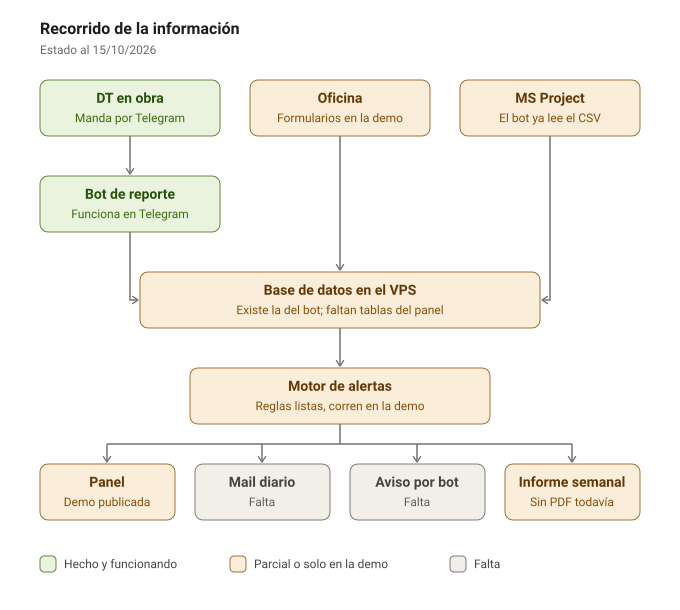

# Seguimiento de obras · Sáez Sánchez

Panel para la coordinación de obras. Muestra en un semáforo el estado de cada obra y de cada director
técnico (DT), avisa cuando algo se pone en rojo y deja cargar lo que no llega por el reporte diario.

Hoy es una **demo con datos ficticios**: cuatro obras y tres DT inventados, con fechas relativas al día
en que se abre. Sirve para mostrar el sistema, ajustarlo con el equipo y practicar la instalación en el VPS.

## Cómo viaja la información



1. **Entrada.** El DT manda fotos y audios por chat y el
   [bot de reporte diario](https://github.com/Leoscd/bot-saez-sanchez) arma el reporte del día. La
   oficina carga en el panel certificados, láminas, requerimientos, controles, actas y el legajo de HyS.
   El cronograma sale de MS Project exportado a CSV.
2. **Base de datos en el VPS.** Todo va a una sola base, la misma del bot.
3. **Motor de alertas.** Revisa las reglas cada hora y cada vez que un DT confirma un reporte, y le pone
   color a cada obra y módulo: verde, amarillo, rojo o crítico.
4. **Salidas.** El panel con el semáforo, un mail de resumen a la mañana, un aviso por el bot cuando
   algo pasa a crítico y el informe semanal por obra.

Cuando se resuelve lo que disparó una alerta (se emite la lámina, se registra el pedido), la alerta se
cierra sola en la próxima revisión.

## Qué tiene el panel

| Sección | Qué muestra |
|---|---|
| Tablero | Matriz obra × módulo con semáforo, indicadores del día y alertas críticas y en rojo |
| Ficha de obra | Una pestaña por módulo: reportes diarios, avance y cronograma (curva S y Gantt), materiales, económico, certificaciones, documentación técnica, requerimientos, higiene y seguridad, calidad, actas y etapas, notas de obra e informe semanal |
| DT | Obras a cargo de cada DT, reportes al día o atrasados y pendientes abiertos |
| Alertas | Listado con filtros por obra, DT, módulo y nivel |
| Informes | Semanal por obra y consolidado de gerencia |
| Cargar | Certificados, láminas, requerimientos, controles de calidad, actas, etapa, legajo de HyS y pedidos |

## Reglas de alerta

Todas están en [`panel/assets/reglas.js`](panel/assets/reglas.js), con los umbrales arriba de todo para
ajustarlos en un solo lugar. Algunas:

| Módulo | Regla | Nivel |
|---|---|---|
| Reportes | DT sin reporte confirmado el último día hábil / 2 días o más | Amarillo / rojo |
| Avance | Obra más de 10 puntos atrasada / tarea crítica 15 puntos detrás de lo previsto | Rojo / crítico |
| Materiales | Fecha límite de pedido = inicio de la tarea − plazo de entrega − 2 días hábiles. Vencida en tarea crítica | Crítico |
| Documentación | Lámina sin emitir 10 días antes de que arranque la tarea que la necesita | Rojo (crítico si la tarea es crítica) |
| Requerimientos | Sin respuesta y traba una tarea crítica que arranca en 7 días o menos | Crítico |
| Económico | Certificado más de 10 puntos por encima del avance físico | Rojo |
| Certificaciones | Aprobado y sin cobrar después de 30 días | Rojo |
| Higiene y seguridad | Incidente en los últimos 7 días / documento del legajo vencido | Rojo |
| Calidad | Hito que exige control (ej. hormigonado) sin control registrado | Crítico |
| Actas | Obra en ejecución sin acta de inicio | Rojo |

## Probarlo en la PC

Con Python instalado, desde la carpeta del repo:

```bash
python -m http.server 8090 --directory panel
```

Abrir <http://localhost:8090>. Lo que se carga queda guardado solo en ese navegador; el botón
**Volver a los datos de ejemplo** lo borra.

## Ponerlo en el VPS

Ver [docs/VPS.md](docs/VPS.md): demo del panel en el VPS en unos 15 minutos y, opcional, el bot de
reporte diario corriendo las 24 h.

## Cómo está hecho

Sin frameworks ni compilación: HTML, CSS y JavaScript que el navegador lee tal cual.

| Archivo | Qué hace |
|---|---|
| `panel/index.html` | La página |
| `panel/assets/config.js` | `DEMO: true` usa los datos ficticios; después va la dirección de la API |
| `panel/assets/api.js` | Conexión con la API, fechas y formatos |
| `panel/assets/reglas.js` | Motor de alertas y cálculos (avance, materiales, económico) |
| `panel/assets/demo.js` | Datos ficticios y backend de prueba en el navegador |
| `panel/assets/app.js` | Vistas y navegación |
| `panel/assets/formularios.js` | Formularios de carga de oficina |
| `panel/assets/graficos.js` | Gantt y curva S |
| `scripts/armar_demo_panel.py` | Junta todo en un solo HTML para compartir la demo como una página |

## Próximos pasos

**Sistema real en el VPS**
- API junto al bot, sobre la misma base de datos, con HTTPS.
- Tablas del panel: personas y roles, obras, requerimientos, presupuesto por rubro, certificados,
  documentos, legajo HyS, controles, actas y alertas.
- Ingreso con la cuenta de Google de cada persona y permisos por rol (DT, coordinación, gerencia).
- Importar el cronograma de MS Project desde el panel.
- Motor de alertas en el servidor, mail de resumen diario y aviso de lo crítico por el bot.

**Después**
- Informes en PDF y adjuntos (actas firmadas, láminas) guardados en el servidor.
- Que el DT cargue requerimientos y controles de calidad por chat.
- Costo de horas de cada DT por obra, desde el sistema de horas.
